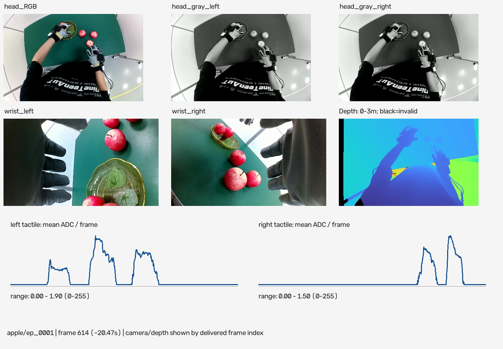

# LoomG2pro Multimodal Manipulation Samples


Four human demonstrations of tabletop manipulation, one episode per object. Each recording combines five camera views with depth, hand motion, tactile responses and head orientation on a common 30 Hz timeline.

| Object | Episode | Frames |
|---|---|---:|
| Apple | [ep_0001](data/apple/ep_0001/) | 1,228 |
| Banana | [ep_0002](data/banana/ep_0002/) | 658 |
| Block | [ep_0002](data/block/ep_0002/) | 596 |
| Cup | [ep_0005](data/cup/ep_0005/) | 559 |



## Explore an episode

Start with `camera/head_RGB.mp4` for the first-person view. The same folder holds stereo grayscale and wrist videos. The English action descriptions in `annotations/auto_actions.json` give inclusive start and end frame indices. Use `meta/timeline/sync.parquet` to locate the corresponding samples.

Depth is stored in millimeters in `head_depth/`, with zero marking invalid pixels. The hand motion capture files in `mocap/` contain 20 nodes per hand. Head and hand trajectories in `world_pose/` use meters. Tactile values in `tactile/` are ADC readings. Apple has 1,132 channels per hand and the other three samples have 1,125. Consult each episode’s tactile layout before comparing channels.


## Download

Install Git LFS, then run:

```bash
git lfs install
git clone https://github.com/CarusAI/loomg2pro-multimodal-data.git
cd loomg2pro-multimodal-data
git lfs pull
```


## Assessment scope

The four episodes listed above contain 3,041 frames in total. They were selected from a 147-episode source delivery. An earlier quality review covered 120 episodes, including these four. The complete archive subsequently passed the 7-Zip extraction check after volume 012 was replaced. Volume 004 still differs from the supplier’s SHA-256 table in its final digit. The earlier sensor-quality review did not cover the 27 subsequently recovered cup episodes.

## Quality and reuse

All four samples have a missing IMU orientation at frame 0. Action annotations begin at frame 1. In each of the four episodes, one frame per hand contains missing world-space coordinates. Apply a separate validity mask for each hand before calculating velocities or using trajectories as training targets. Video checks covered reported frame counts and decoding at the beginning, middle and end of each video. Five frames per episode were sampled for depth coverage. The shared frame index supports aligned playback. Acquisition timing offsets, geometric accuracy and robot retargeting have yet to be independently validated.

Each episode includes the source license (CC BY-NC-SA 4.0). See the [license accompanying the apple sample](data/apple/ep_0001/LICENSE).
