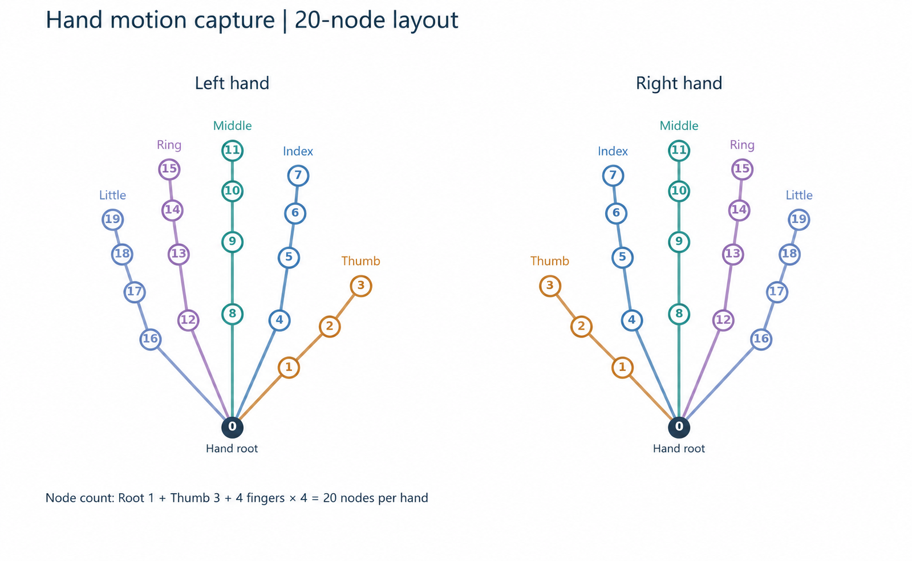

# LoomG2pro Multimodal Manipulation Samples

How does a person grasp an object, pass it between hands and release it at a target? These four tabletop demonstrations let you study the same movement through five camera views, depth, hand motion capture and tactile readings. English descriptions identify action intervals. All streams share a delivered 30 Hz frame index.

## Try one episode and give feedback

After [downloading the samples](#download), open the [banana handover walkthrough](data/banana/ep_0002/README.md). Frames 339–399 cover the interval when both hands hold the banana. Run the Python example from the episode directory. At frame 369, the distance between the two wrist anchors should be about **0.150 m**.

Which experiment would you try with these samples? What data, labels or tools would help you run it? [Share feedback in a GitHub issue](https://github.com/CarusAI/loomg2pro-multimodal-data/issues/new). If you got stuck, include the episode, file and step so we can reproduce the problem.

## What can you model?

| Research use | Inputs | Prediction or experiment |
|---|---|---|
| Vision-language-action (VLA) prototyping | Recent head or wrist images and a task instruction derived from the English description | Predict the next segment of **human hand motion**. Derive wrist displacement or fingertip trajectories from the world-space arrays as action targets. |
| Video-language understanding | A video clip and a question such as “Which hand holds the banana?” | Predict the manipulation phase or locate the handover in the video. Use the annotated intervals as references and keep their descriptions out of the model input when evaluating recognition. |
| Visual and tactile fusion | Wrist video and per-hand tactile ADC histories | Compare video alone with video plus touch for recognizing grasp, shared hold and release. The interval labels support phase-level evaluation. Exact contact onset requires separate annotation. |
| Bimanual imitation and hand retargeting | Left and right wrist trajectories and 20 hand nodes per side | Recover the order of approach, grasp and release, then map the motion to a specific robot and test reachability, collisions and handover success in simulation. |

### A first VLA experiment

Use the banana episode with the instruction *“Pass the banana from your right hand to your left hand, then place it in the box.”* This instruction is derived from the episode annotations. At frame *t*, give the model only the instruction and images available through *t*. As a target, take the two wrist positions in `world_pose/world_motion.h5` (`hand_anchor_m`) over the next 15 frames and subtract their positions at *t*. This yields half a second of future motion in meters, relative to each wrist’s own starting position.

Compare predicted wrist paths with the recorded paths using mean Euclidean error per hand, masking missing positions at the reference and target frames. A stationary-wrist baseline predicts zero displacement. Frames **339–399** cover the annotated two-hand hold and provide a concrete interval to inspect. For robot control, define the target robot’s action space, transform the demonstrations into that space and validate execution on the robot.

## Choose a demonstration

| Object | Episode | Frames | What to inspect |
|---|---|---:|---|
| Apple | [ep_0001](data/apple/ep_0001/) | 1,228 | Sequential placement of five apples on a plate |
| Banana | [ep_0002](data/banana/ep_0002/) | 658 | Banana handover, with both hands holding at frames 339–399 |
| Block | [ep_0002](data/block/ep_0002/) | 596 | Block handover, with both hands holding at frames 334–355 |
| Cup | [ep_0005](data/cup/ep_0005/) | 559 | Cup handover, with both hands holding at frames 264–311 |


## Explore an episode

Start with `camera/head_RGB.mp4` for the first-person view. The same folder holds stereo grayscale and wrist videos. The English action descriptions in `annotations/auto_actions.json` give inclusive start and end frame indices. Use `meta/timeline/sync.parquet` to locate the corresponding samples.

Depth is stored in millimeters in `head_depth/`, with zero marking invalid pixels. The hand motion capture files in `mocap/` contain 20 nodes per hand. Tactile values in `tactile/` are ADC readings. Apple has 1,132 channels per hand and the other three samples have 1,125. Consult each episode’s tactile layout before comparing channels.

Head and hand positions in `world_pose/` are expressed in meters. The head IMU file, `imu/head_imu.h5`, stores one orientation quaternion per delivered frame in
`aligned/orientation`, in `(x, y, z, w)` order. Each quaternion rotates vectors from the current IMU sensor frame into the sensor frame of the episode’s first
raw IMU sample. Frame 0 has no valid orientation in any of the four samples.



## Download

Install Git LFS, then run:

```bash
git lfs install
git clone https://github.com/CarusAI/loomg2pro-multimodal-data.git
cd loomg2pro-multimodal-data
git lfs pull
```

## Assessment scope

Use these four examples to test data loading, target construction and model inference. For performance estimates on a larger collection, hold out entire episodes before sampling clips. Adjacent frames from the same demonstration are strongly correlated.

The four episodes listed above contain 3,041 frames in total. They were selected from a 147-episode source delivery. An earlier quality review covered 120 episodes, including these four. The complete archive subsequently passed the 7-Zip extraction check after volume 012 was replaced. Volume 004 still differs from the supplier’s SHA-256 table in its final digit. The earlier sensor-quality review did not cover the 27 subsequently recovered cup episodes.

## Quality and reuse

For all four episodes, video frame counts matched the episode metadata. We decoded the first, middle and last frame of each video and sampled five depth frames per
episode to measure nonzero pixel coverage. These checks support frame-indexed playback. Acquisition-time offsets and metric depth accuracy remain unverified.

In each episode, `left_world_m` and `right_world_m` each contain one frame with non-finite coordinates. Mask invalid values separately for each hand. When
computing velocity, require valid positions at both ends of each frame interval. Action annotations use inclusive frame indices and begin at frame 1.

The samples contain human demonstrations. Robot action commands, a retargeting mapping and robot execution results are outside the scope of this release.

Each episode includes the source license (CC BY-NC-SA 4.0). See the [license accompanying the apple sample](data/apple/ep_0001/LICENSE).
